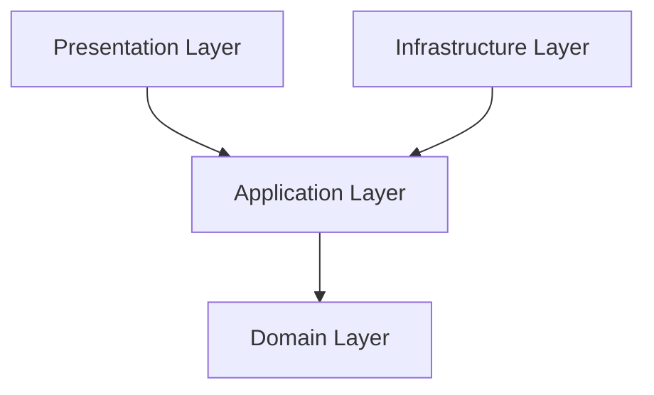

# Qatu Marketplace Backend Architecture

## 1.1 Overview

Qatu Marketplace follows the **Onion Architecture** pattern. This architecture ensures that the core domain logic remains independent of external frameworks, databases, and user interfaces. By keeping the domain isolated, we achieve a highly testable, maintainable, and scalable system.

For architectural decisions, please refer to [ADR-005 (Backend Architecture)](#) and the [Wiki](#).

## 1.2 Layers (Detailed)

### Domain Layer

- **Purpose:** Contains the core business logic, entities, and rules of the application. It is the heart of the system.
- **Components:** Entities (e.g., `Product`, `Profile`), Value Objects, Domain Events, and Repository Interfaces (e.g., `IProductRepository`, `IProfileRepository`).
- **Dependencies:** None. It does not depend on any outer layers.
- **What does NOT belong here:** Express.js code, database queries, ORM models, or infrastructure concerns.

### Application Layer

- **Purpose:** Orchestrates business use cases. It directs the flow of data to and from the domain layer.
- **Components:** Use Cases (Interactors, e.g., `ListProductsUseCase`, `RegisterBuyerUseCase`, `LoginUseCase`), DTOs (Data Transfer Objects), and Application Interfaces.
- **Dependencies:** Depends ONLY on the Domain layer.
- **What does NOT belong here:** HTTP routing, API requests, database implementations.

### Infrastructure Layer

- **Purpose:** Provides implementations for interfaces defined in the inner layers (e.g., repositories). Handles communication with external systems.
- **Components:** Database Implementations (Sequelize), Message Brokers (RabbitMQ), External APIs, Authentication mechanisms (Supabase Auth).
- **Dependencies:** Depends on the Application and Domain layers.
- **What does NOT belong here:** Core business rules.

#### Persistence

- **Repositories:** `ProfileRepository`, `ProductRepository`, `CategoryRepository`.

> **Note:** `ProductRepository.findAll` explicitly filters `state = 'published' AND deleted_at IS NULL` in SQL. It does **not** rely on the RLS policy `"Published products are publicly readable"` because the backend connects with the `qatu` DB user, which is the table owner and bypasses RLS by default. RLS remains active for end-user access via Supabase.

#### Catalog search and filters (US-05 / US-06)

`GET /v1/products` accepts `search`, `category_id`, `min_price`, `max_price`, `seller_id`, `sort_by`, `sort_order`, `page` and `limit`. All filters are combined with `AND` and every value is passed as a bound parameter (never concatenated), except the `ORDER BY` column, which comes from a fixed whitelist.

- **Keyword search** matches the product `name` and `description` and is case-insensitive. It combines two strategies inside one parenthesised condition:
  - Full-text (`search_vector @@ plainto_tsquery('simple', ...)`) for multi-word terms in any order.
  - `ILIKE '%term%'` for partial words, so `phone` finds "Smartphone" and "Headphones". The term is escaped with `escapeLikePattern`, so `%`, `_` and `\` are matched literally.
- **Indexes:** the full-text GIN index (`idx_products_search`) and the trigram GIN indexes created by migration 27 (`idx_products_name_trgm`, `idx_products_description_trgm`) let PostgreSQL resolve the whole `OR` with a `BitmapOr` instead of scanning the table. `category_id` and `price` already have their own indexes.
- **Validation:** `max_price` must be greater than or equal to `min_price` (otherwise `400 VALIDATION_ERROR` on `max_price`). An empty result is a normal `200` with `data: []`, `meta.total: 0` and `meta.total_pages: 0`.
- **Categories:** `GET /v1/categories` lists active categories ordered by `position` and `name` so clients can build the category filter. The total is counted in a separate query, so it stays correct for out-of-range pages.

### Presentation Layer

- **Purpose:** Acts as the entry point for the application. Handles HTTP requests and responses.
- **Components:** Express.js Controllers, Routes, Middleware, Request Validation (Joi).
- **Dependencies:** Depends on the Application and Infrastructure layers.
- **What does NOT belong here:** Business logic or direct database queries.

## 1.3 Dependency Rule

The overriding rule of Onion Architecture is that **dependencies point inward**. Inner layers do not know anything about outer layers.



Dependency Inversion is applied heavily. When an Application Use Case needs to fetch data, it relies on a Repository Interface defined in the Domain/Application layer, while the actual implementation lives in the Infrastructure layer.

## 1.4 Folder Structure

```text
src/
├── domain/               # Core business logic
│   ├── entities/         # Domain entities (e.g., Product.js, User.js)
│   ├── valueObjects/     # Immutable value objects
│   └── repositories/     # Repository interfaces
├── application/          # Use cases and DTOs
│   ├── useCases/         # e.g., PlaceOrderUseCase.js
│   └── dtos/             # Data Transfer Objects
├── infrastructure/       # External system implementations
│   ├── database/         # Sequelize configurations and models
│   ├── repositories/     # Implementations (e.g., UserRepository.js)
│   ├── messaging/        # RabbitMQ publishers/consumers
│   └── auth/             # Supabase Auth integrations
└── presentation/         # HTTP and UI
    ├── controllers/      # Express controllers
    ├── routes/           # Express routes
    ├── middlewares/      # Express middlewares
    ├── validators/       # Joi schemas
    └── docs/             # OpenAPI 3.1 specification & Swagger UI
```

Files use PascalCase for classes (e.g., `PlaceOrderUseCase.js`, `UserRepository.js`).

## 1.5 Cross-Cutting Concerns

- **Authentication:** Handled via Supabase Auth in the Infrastructure layer. A custom middleware in the Presentation layer verifies the JWT token.

### Authentication (HttpOnly Cookies — Sprint 4+)

Per **ADR-012**, the API uses HttpOnly cookies as the primary session mechanism. Bearer tokens are deprecated but supported during the Sprint 4 migration window (will be removed in Sprint 5).

#### Cookie contract

| Cookie          | Flags                                               | TTL | Purpose                                        |
| --------------- | --------------------------------------------------- | --- | ---------------------------------------------- |
| `access_token`  | HttpOnly; Secure (in prod); SameSite=Strict; Path=/ | 1h  | Supabase access JWT                            |
| `refresh_token` | HttpOnly; Secure (in prod); SameSite=Strict; Path=/ | 30d | Supabase refresh token (rotated by `/refresh`) |
| `csrf_token`    | SameSite=Strict; Path=/ (NOT HttpOnly)              | 1h  | Double-submit CSRF                             |

#### SameSite=Strict

The three session cookies use `SameSite=Strict`. This is only valid when the frontend and backend share the same registrable domain (same site). Refer to `README.md` §"SameSite=Strict deployment requirement" for the valid/invalid deployment matrix. If production ever requires a cross-site deployment, change `sameSite` to `'none'` in `cookieHelper.js` (HTTPS only) — the CSRF defense does not depend on the SameSite flag.

#### Endpoints

- `POST /v1/auth/register` — sets 3 cookies, returns `{ user, profile, roles }` (no token)
- `POST /v1/auth/login` — same
- `GET /v1/auth/me` — returns current user (requires cookie OR Bearer)
- `POST /v1/auth/refresh` — rotates access + refresh cookies (CSRF-exempt; the refresh token IS the auth)
- `POST /v1/auth/logout` — revokes on Supabase, clears cookies, returns 204 (idempotent)

#### Middleware chain

1. `cookieParser()` — parses `req.cookies`
2. `csrfMiddleware` — enforces `X-CSRF-Token` on mutating requests, EXCEPT `/v1/auth/*` and requests without an `access_token` cookie
3. `authMiddleware` — per-route; accepts cookie OR Bearer (transition); sets `req.authMethod` and `req.user`
4. Controllers — call use cases, set/clear cookies via `cookieHelper`, respond with `{ user, profile, roles }` DTOs

#### Migration to Bearer-less (Sprint 5)

Remove the Bearer fallback from `authMiddleware`. Update `securitySchemes/bearerAuth.yaml` → remove entirely. Regenerate OpenAPI bundle.

- **Authorization:** Enforced at the database level using PostgreSQL Row Level Security (RLS). Policies are established in migrations.
- **Validation (US-24):** Every route that accepts a body, query, or path value runs `validateRequest` with a Joi schema before the use case. Invalid input returns `400` with `error.code = VALIDATION_ERROR` and `error.details[]` (`field`, `message`). Unknown fields are stripped. Repositories send user values only through Sequelize `replacements` (`:name` placeholders). `sort_by` is an allow-list, and `LIKE` wildcards in search are escaped. A payload such as `'; DROP TABLE products;--` is stored or searched as text.
- **API Specification:** Modular OpenAPI 3.1.0 contract maintained in `src/presentation/docs/` as the single source of truth; served via Swagger UI at `/api-docs`.
- **Logging:** Centralized using Pino across all layers for consistent and performant logging.
- **Messaging:** Treated as an infrastructure concern using RabbitMQ. Publishers and consumers live in the Infrastructure layer.
- **Error Handling:** Errors propagate from the Domain layer outwards, mapped to corresponding HTTP status codes in a global error handling middleware in the Presentation layer.

## 1.6 Testing Strategy per Layer

- **Domain:** Pure unit tests, no mocks needed.
- **Application:** Unit tests with mocked repositories.
- **Infrastructure:** Integration tests with Testcontainers (real PostgreSQL, RabbitMQ).
- **Presentation:** Integration tests with Supertest.

## 1.7 Architecture Decision Records

- ADR-001: Use Node.js for Backend (Link to Wiki)
- ADR-002: Use Express.js Framework (Link to Wiki)
- ADR-003: Use Supabase for Authentication (Link to Wiki)
- ADR-004: PostgreSQL as Primary Database (Link to Wiki)
- ADR-005: Backend Onion Architecture (Link to Wiki)
- ADR-006: RabbitMQ for Asynchronous Messaging (Link to Wiki)
- ADR-007: Testcontainers for Integration Tests (Link to Wiki)
- ADR-008: OpenAPI for API Documentation (Link to Wiki)

## 1.8 References

- [OpenAPI Specification](OPENAPI.md)
- [Wiki: Architecture/Overview](#)
- [Wiki: Architecture/Backend](#)
- [Wiki: Architecture/Data-Model](#)
- [Wiki: Architecture/Security](#)
- [Wiki: Architecture/API-Design](#)

### Migrations

Migrations are versioned in `src/infrastructure/persistence/migrations/` and run via Sequelize CLI. The order is defined by the filename timestamp prefix. Every migration:

- Creates one logical unit (a table, a group of related triggers, or a set of seed data).
- Wraps statements in a transaction.
- Includes a working `down` step.
- Enables RLS and adds policies for every table.
- Uses `IF NOT EXISTS` / `IF EXISTS` for idempotency.

Seeders live in `src/infrastructure/persistence/seeders/` and are idempotent. They populate roles, categories, and the admin user for development and staging.

See [`.docs/MIGRATIONS.md`](MIGRATIONS.md) for the full guide.

## Container Topology

The API is containerized in four compose files under the repo root. The base file is never run on its own; it is combined with a dev, prod, or dev-tools override.

```
                    ┌─────────────────────────────────────────────┐
                    │              qatu-net (bridge)              │
                    │                                             │
  host:3000 ────────┤  api          postgres         rabbitmq     │
  (dev only)        │  node:26      postgres:17      rabbitmq:4   │
                    │  UID 1001     UID 999          UID 999       │
                    │                :5432           :5672/:15672  │
                    │                  │                 │         │
  host:15672 ───────┤  (rabbitmq management UI, dev only)        │
                    │                                             │
  host:8080 ────────┤  pgadmin (dev-tools override only)          │
                    │  dpage/pgadmin4:9                           │
                    └─────────────────────────────────────────────┘
                       │
                       │  external: qatu-net (shared with client repo)
                       │
                    [client repo's nginx proxies /v1/ → api:3000]
```

### Base (`docker-compose.yml`)

| Service    | Image                            | Exposed        | Purpose                                                                        |
| ---------- | -------------------------------- | -------------- | ------------------------------------------------------------------------------ |
| `postgres` | `postgres:17-alpine`             | `expose: 5432` | Application DB + Supabase `auth` compatibility schema (created by migration 1) |
| `rabbitmq` | `rabbitmq:4.1-management-alpine` | `expose: 5672` | Message broker (ADR-014)                                                       |
| `api`      | built from `./Dockerfile`        | `expose: 3000` | Express API                                                                    |

All services use `security_opt: ["no-new-privileges:true"]` and `cap_drop: ["ALL"]` (postgres re-adds `CHOWN, DAC_OVERRIDE, SETGID, SETUID` for its init scripts).

### Development (`docker-compose.dev.yml`)

- `api` mounts source for hot reload, runs `pnpm dev` (nodemon), builds `target: build` stage (has dev deps).
- `api` opens host `:3000`.
- `rabbitmq` opens host `:15672` (management UI).
- `postgres` stays internal.
- `extra_hosts: ["host.docker.internal:host-gateway"]` on `api` for Linux Supabase CLI access.

### Production (`docker-compose.prod.yml`)

- `api` builds `target: runtime` (multi-stage, no dev deps).
- **No host ports are opened.** The client repo's compose runs nginx on port 80/443 and proxies `/v1/` over the shared `qatu-net` external network.
- `restart: unless-stopped` on all services.
- Migrations run on startup via `entrypoint.sh`.
- Healthcheck on `/health` every 30s.

### Dev tools (`docker-compose.dev-tools.yml`, optional)

- Adds `pgadmin` on host `:8080` for DB inspection.
- Never deployed to production.
- Requires `cap_add: [CHOWN, DAC_OVERRIDE, SETGID, SETUID]` (pgAdmin writes to its config dir).

### Network isolation guarantees

| Rule                                                       | Enforced by                                                                                                      |
| ---------------------------------------------------------- | ---------------------------------------------------------------------------------------------------------------- |
| Postgres is not reachable from the host in prod            | Base uses `expose`, not `ports`. Prod override adds nothing.                                                     |
| RabbitMQ management is not reachable from the host in prod | `rabbitmq:4.1-management-alpine` includes the UI, but only `docker-compose.dev.yml` opens `:15672`.              |
| API is not reachable from the host in prod                 | `docker-compose.prod.yml` does not publish `:3000`. Only nginx (client repo) reaches it over the shared network. |
| No secrets in images                                       | All config via `.env`; Dockerfile has no `ARG` for secrets.                                                      |

For the full operator guide, see [CONTAINERIZATION.md](CONTAINERIZATION.md).
